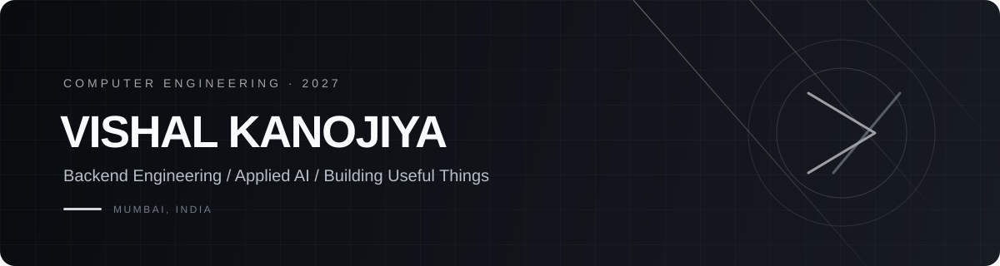

<!-- Profile README for github.com/vishalk1520 -->

  

  
  
  
  

<h3 align="center">Computer Engineering student · Backend & Full-Stack Developer</h3>

  I like building software that solves real problems — from distributed backends and data products 
  to practical AI workflows. Curious about the details, happiest when an idea becomes a working system.

  <a href="#selected-work">Selected work</a> &nbsp;·&nbsp;
  <a href="#toolkit">Toolkit</a> &nbsp;·&nbsp;
  <a href="#beyond-the-code">Beyond the code</a> &nbsp;·&nbsp;
  <a href="#lets-connect">Connect</a>

01 / Selected work
Three projects. Three different real-world problem spaces.
<table>
  <tr>
    <td width="50%" valign="top">
      <h3>🍱 AnnaSetu</h3>
      <strong>Food rescue & distribution network</strong>
      
A platform connecting food donors, NGOs and volunteers to make surplus food collection more coordinated.

      <ul>
        <li>Designed a seven-service Spring Boot architecture.</li>
        <li>Built geospatial matching with PostGIS.</li>
        <li>Used Kafka for event-driven communication.</li>
        <li>Added atomic claiming, JWT auth and role-based dashboards.</li>
        <li><strong>83 automated tests passing.</strong></li>
      </ul>
      Java 21 · Spring Boot · React · PostgreSQL · PostGIS · Redis · Kafka · Docker
    </td>
    <td width="50%" valign="top">
      <h3>🌾 BharatMandiAI</h3>
      <strong>Agricultural market intelligence</strong>
      
A data-backed tool to help compare mandi prices, forecast trends and find better selling destinations.

      <ul>
        <li>LightGBM price forecasting: <strong>13.5% MAPE</strong>.</li>
        <li>Anomaly detection: <strong>0.86 F1-score</strong>.</li>
        <li>Ranked mandis using estimated net returns.</li>
        <li>Added LangGraph recommendation workflows and async processing.</li>
      </ul>
      Python · FastAPI · PostgreSQL · Redis · Celery · LangGraph · LightGBM · React
    </td>
  </tr>
  <tr>
    <td colspan="2" valign="top">
      <h3>🏙️ CivicPulse Mumbai</h3>
      <strong>Civic data analytics</strong>
      
Exploring civic complaint patterns across Mumbai through a validated analytics pipeline and dashboard.

      <ul>
        <li>Worked with 10 years of data, 24 wards and 18 categories.</li>
        <li>Prepared 420 validated Gold records; reached 95% validation success.</li>
        <li>Built nine API endpoints and five dashboard views.</li>
        <li>Added trend analysis, reconciliation and outlier detection.</li>
      </ul>
      Python · FastAPI · React · TypeScript · PostgreSQL
    </td>
  </tr>
</table>02 / Toolkit
Area	Tools I work with
Languages	Java 21 · Python · SQL · JavaScript · TypeScript
Backend	Spring Boot · FastAPI · Node.js · Express · REST APIs
Architecture	Microservices · Apache Kafka · JWT · Celery
Frontend	React · Next.js · HTML · CSS · Bootstrap
Data stores	PostgreSQL · PostGIS · MySQL · MongoDB · Redis · SQLite
AI & data	scikit-learn · LightGBM · LangGraph · RAG · Semantic Search
Workflow	Docker · Git · GitHub · VS Code · Google Colab

03 / A few numbers

  
  

  
  

04 / Beyond the code
- AI Intern — Codec Technologies Pvt. Ltd. Built a customer-service chatbot using RAG, embeddings, semantic search and prompt engineering.
- NAKSHATRA 2026 — Qualified for Round 2 of a national-level 24-hour hackathon.
- Learning — Working through DSA, backend engineering, system design and applied machine learning.
- Certifications — HackerRank SQL · Oracle Machine Learning with Java.
05 / Let's connect

  <a href="mailto:vishalkanojiya1512@gmail.com">vishalkanojiya1512@gmail.com</a>
  &nbsp; / &nbsp;
  <a href="https://github.com/vishalk1520">github.com/vishalk1520</a>

  Less noise. More building. Always learning.

